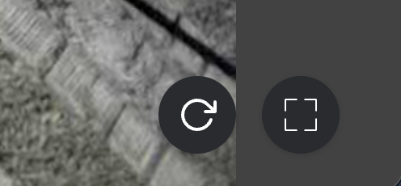

# Ring Video Rotator

A small Chrome extension that adds a **rotate button** to camera videos on
[account.ring.com](https://account.ring.com), for cameras that are mounted
sideways or upside down.

  

<em>The rotate button in Ring's live view controls, next to fullscreen.</em>

## Features

- **Rotate in 90° steps.** Each click turns the video 90° clockwise. Four clicks bring it back to normal.
- **Fits in the player.** A video turned sideways is scaled down so all of it stays inside the player, without moving anything else on the page.
- **Looks like part of Ring.** In live view the button sits in Ring's own control bar and copies the style of Ring's buttons.
- **Handles Ring's page changes.** Ring loads videos without reloading the page, and the extension adds the button to each new video. The button stays in place when Ring redraws its controls.
- **No permissions.** The extension only runs on `account.ring.com`. It makes no network requests and stores nothing.

## Install

The extension isn't in the Chrome Web Store, so you load it from source:

1. Download this repository: clone it, or use **Code → Download ZIP** and unzip it.
2. Open `chrome://extensions` in Chrome.
3. Turn on **Developer mode** (top right).
4. Click **Load unpacked** and select the downloaded folder (the one with `manifest.json` in it).
5. Refresh any open account.ring.com tabs.

## Usage

1. Open a live view or a recorded event on [account.ring.com](https://account.ring.com).
2. Click the rotate button. In live view it's just left of the fullscreen button. Other players show it in the video's top-left corner.
3. Keep clicking until the picture is the right way up.

Hover over the button to see the current rotation.

## How it works

The extension is a single content script with plain JavaScript and CSS, and no build step.

- A `MutationObserver` watches the page for `<video>` elements, since Ring adds and removes players without reloading the page.
- Rotation is a CSS `transform`. For 90° and 270°, the video is also scaled by `min(width / height, height / width)` so it still fits in its original box.
- The script finds Ring's control bar by its `data-testid` attributes (`…controls__fullscreen`) rather than by class names. Ring generates its class names automatically, and they change with each Ring release.
- The button copies the classes of Ring's fullscreen button, so it picks up Ring's look and matches any restyling.

| File | Purpose |
| --- | --- |
| `manifest.json` | Manifest V3; runs the content script on `https://account.ring.com/*` |
| `content.js` | Finds videos, adds the button, applies the rotation |
| `content.css` | Styles for the button outside Ring's control bar and for the icon |
| `icons/` | Toolbar and extension icons. `icon.svg` (48, 128 px) and `icon-small.svg` (16, 32 px) are the sources for the PNGs |

## Development

Edit the files, click the reload icon on the extension's card in
`chrome://extensions`, then refresh the Ring tab.

## Limitations

- **Rotation isn't remembered.** It resets when Ring loads a new video, for example when you open another event.
- **Fullscreen may undo it.** Chrome removes transforms from an element that's fullscreen itself, so the rotation would be lost if Ring made the video element itself fullscreen.
- **Ring's site can change.** If Ring renames its `data-testid` attributes, the button falls back to floating over the video, where Ring's controls overlay may hide it.

## Disclaimer

This is an unofficial personal project. It isn't affiliated with, endorsed
by, or supported by Ring or Amazon. "Ring" is a trademark of its owner.
